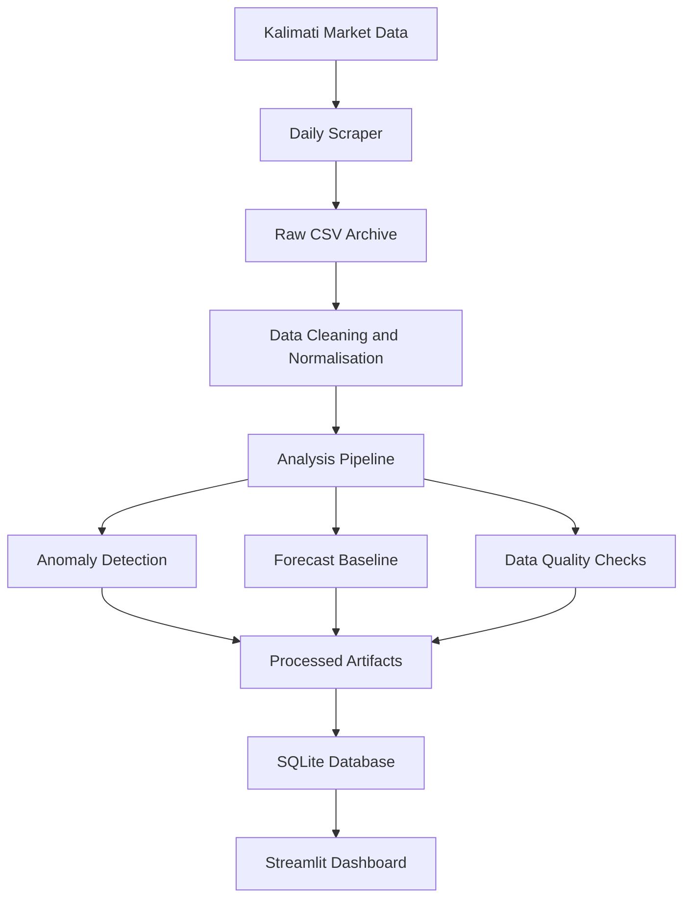

# Kalimati Saathi

### Vegetable Price Intelligence & Market Analytics for Nepal

Kalimati Saathi is a Python-based data engineering and analytics application that collects vegetable and fruit prices from the Kalimati market, maintains historical price records, identifies unusual price movements, and visualises market trends.

The project combines **web scraping, data validation, time-series analysis, anomaly detection, baseline forecasting, SQLite, Streamlit, and automated data pipelines**.

It was developed to explore how publicly available agricultural market data can be transformed into structured, accessible, and interpretable analytics.

> **Project Focus:** Python · Data Engineering · Time-Series Analytics · Workflow Automation

---

## Overview

Kalimati Saathi processes daily commodity prices published by the Kalimati Fruits and Vegetables Market.

The documented dataset includes:

| Area | Project Scope |
| :--- | :--- |
| Commodities | 80+ |
| Historical Records | 363,000+ reported rows |
| Historical Coverage | Backfilled market records, including early sparse data |
| Analytics | Anomaly detection, trend analysis, baseline forecasting |
| Storage | SQLite |
| Dashboard | Streamlit + Altair |
| Automation | GitHub Actions and optional local cron |

The application is designed to provide descriptive market insights while making data quality and historical coverage visible to users.

---

## System Architecture



The pipeline separates data collection, validation, analytical processing, and presentation.

This structure allows individual stages to be executed and checked independently.

---

## Core Features

### 1. Automated Market Data Collection

The scraper collects daily commodity prices from the Kalimati market website.

The documented implementation handles:

- Minimum, maximum, and average prices
- 80+ commodities
- Nepali-script commodity names
- CSRF-aware requests
- Historical date-based collection
- Raw data archiving

Historical collection is supported through a separate backfill script.

### 2. Historical Data Processing

The project maintains a historical dataset containing more than 363,000 reported price records.

Processing includes:

- Historical data consolidation
- Duplicate handling
- Commodity name normalisation
- Data quality checks
- Coverage assessment
- Date-specific processing

The dataset uses confidence categories to distinguish records with different levels of historical coverage.

### 3. Anomaly Detection

The anomaly detection workflow compares commodity prices with a rolling seven-day median baseline.

It identifies unusual price increases and decreases using percentage deviations.

This provides a simple, interpretable method for highlighting price movements that may deserve closer examination.

An anomaly is a statistical signal, not proof of market manipulation or incorrect pricing.

### 4. Baseline Price Forecasting

The application generates next-day price estimates using a rolling seven-day median baseline.

The baseline supports:

- Next-day reference values
- Forecast comparisons
- Upward and downward change rankings
- Commodity-level analysis

This is a statistical baseline, not a trained predictive model.

Forecast outputs should not be interpreted as guaranteed future market prices.

### 5. Data Quality and Confidence Assessment

The system evaluates historical coverage and record-level quality.

Checks include:

- Missing or limited daily coverage
- Invalid price relationships
- Zero or negative prices
- Statistical outliers
- Commodity naming inconsistencies
- Historical confidence categories

### 6. Automated Market Brief

The analysis pipeline generates a Markdown summary of current market conditions.

This provides a compact overview of the processed market information.

---

## Interactive Dashboard

The Streamlit application organises market analytics into six tabs.

| Dashboard Tab | Function |
| :--- | :--- |
| **Overview** | Market brief, leading price chart, and pipeline status |
| **Price Explorer** | Commodity filters, date selection, and day-over-day comparisons |
| **Anomaly Watchlist** | Price deviations, spikes, and drops |
| **Forecast** | Next-day baseline estimates and change rankings |
| **Commodity Trends** | Historical price charts with minimum and maximum ranges |
| **Data Quality** | Coverage severity, quality issues, and source audits |

The interface includes Altair visualisations, KPI cards, and CSV export functionality.

---

## Technology Stack

| Technology | Purpose |
| :--- | :--- |
| Python | Data collection and processing |
| Requests | HTTP requests |
| Beautiful Soup | HTML parsing |
| lxml | Document parsing |
| Pandas | Data transformation and analysis |
| Scikit-learn | Supporting analytical utilities |
| SQLite | Local structured data storage |
| Streamlit | Interactive dashboard |
| Altair | Charts and visualisations |
| GitHub Actions | Scheduled pipeline automation |

The project uses lightweight statistical methods and does not require a GPU.

---

## Data Pipeline

The main workflow is orchestrated through:

```bash
python run_daily_pipeline.py
```

### Pipeline Stages

1. Fetch daily market prices.
2. Process and validate collected records.
3. Generate anomaly reports.
4. Calculate the forecasting baseline.
5. Generate a market brief.
6. Audit commodity name normalisation.
7. Generate data quality reports.
8. Apply internal quality flags.
9. Update pipeline status artifacts.
10. Load processed data into SQLite.
11. Run post-processing smoke tests.

Individual scripts can also be executed separately for development and validation.

---

## Getting Started

### Prerequisites

- Python 3.10+
- pip
- Internet connection for fresh data collection

### 1. Clone the Repository

```bash
git clone https://github.com/GaneshPokharel-tech/kalimati-saathi.git
cd kalimati-saathi
```

### 2. Create a Virtual Environment

```bash
python -m venv .venv
```

Activate it on macOS or Linux:

```bash
source .venv/bin/activate
```

On Windows:

```powershell
.venv\Scripts\activate
```

### 3. Install Dependencies

```bash
pip install -r requirements.txt
```

### 4. Run the Data Pipeline

From the project root:

```bash
python run_daily_pipeline.py
```

### 5. Launch the Dashboard

```bash
streamlit run dashboard/app.py
```

Open the local URL displayed by Streamlit, usually:

```text
http://localhost:8501
```

---

## Historical Data Collection

### Fetch a Specific Date

```bash
python scraper/fetch_kalimati_prices.py --date 2025-01-15
```

### Run Historical Backfill

```bash
python scraper/backfill_kalimati_history.py
```

The backfill script processes the configured historical date range.

Historical collection can take time depending on the selected period and source availability.

---

## Individual Analysis Commands

### Anomaly Detection

```bash
python -m analysis.anomaly_report
```

### Forecast Baseline

```bash
python -m analysis.forecast_baseline
```

### Internal Quality Flags

```bash
python -m analysis.generate_policy_flags
```

### Market Brief

```bash
python -m analysis.generate_market_brief
```

### Commodity Normalisation Audit

```bash
python -m analysis.commodity_normalization_audit
```

### Data Quality Audit

```bash
python -m analysis.data_quality_audit
```

### Load Processed Data into SQLite

```bash
python storage/load_history_to_sqlite.py
```

### Run Pipeline Smoke Tests

```bash
python ops/smoke_test_pipeline.py
```

---

## Historical Confidence Categories

Historical records are grouped according to their documented coverage and reliability characteristics.

| Category | Documented Period | Interpretation |
| :--- | :--- | :--- |
| `low_confidence_historical` | Nov 2013 – Oct 2014 | Sparse early records |
| `medium_confidence_historical` | Nov 2014 – Apr 2015 | Partial historical coverage |
| `stronger_historical` | May 2015 – Jan 2026 | Better-covered historical records |
| `current_live` | Feb 2026 onward | Current collection period |

The default anomaly detection and forecasting window uses:

- `stronger_historical`
- `current_live`

These categories are internal data quality labels, not statistical confidence intervals.

---

## Data Quality Rules

### Daily Row Coverage

The pipeline uses internal thresholds to flag dates with limited data.

| Severity | Daily Rows | Treatment |
| :--- | ---: | :--- |
| `normal` | 30 or more | Accept |
| `low` | 10–29 | Flag for review |
| `critical_low` | Fewer than 10 | Exclude |

### Price Quality

| Issue | Detection Rule | Treatment |
| :--- | :--- | :--- |
| Invalid price relationship | Minimum price exceeds maximum price | Exclude |
| Zero or negative price | Average price is zero or below | Exclude |
| Statistical outlier | Outside IQR × 3.0 fences | Flag for review |

These rules are implemented as internal data quality controls. They are not regulatory determinations.

---

## Data Model

Processed records are stored in SQLite.

The main historical dataset contains fields such as:

| Field | Description |
| :--- | :--- |
| `requested_date_ad` | Requested Gregorian date |
| `scrape_date_bs` | Bikram Sambat date from the source |
| `commodity` | Commodity name |
| `unit` | Unit of measurement |
| `min_price` | Minimum recorded price |
| `max_price` | Maximum recorded price |
| `avg_price` | Average recorded price |
| `fetched_at_utc` | UTC collection timestamp |

The application also maintains processed artifacts for anomalies, forecasts, confidence labels, and data quality reporting.

---

## Pipeline Automation

The project supports automated daily processing through GitHub Actions.

Workflow:

```text
.github/workflows/daily_pipeline.yml
```

The documented schedule runs daily at:

```text
01:15 UTC
```

After successful execution, the workflow commits updated processed artifacts using:

```text
Automated daily pipeline update
```

### Manual GitHub Actions Run

1. Open the repository's `Actions` tab.
2. Select `Daily Kalimati Pipeline`.
3. Click `Run workflow`.

### Optional Local Cron

A local cron configuration is also provided.

```bash
bash ops/install_cron.sh
```

The documented local schedule is 07:05.

Review the script and local timezone configuration before installing scheduled jobs.

### Shell Wrapper

```bash
bash run_daily_pipeline.sh
```

The wrapper supports logged pipeline execution.

---

## Project Structure

```text
kalimati-saathi/
│
├── scraper/
│   ├── fetch_kalimati_prices.py
│   └── backfill_kalimati_history.py
│
├── analysis/
│   ├── history_confidence.py
│   ├── anomaly_report.py
│   ├── forecast_baseline.py
│   ├── generate_policy_flags.py
│   ├── generate_market_brief.py
│   ├── commodity_normalization_audit.py
│   ├── data_quality_audit.py
│   └── trend_report.py
│
├── storage/
│   └── load_history_to_sqlite.py
│
├── dashboard/
│   └── app.py
│
├── ops/
│   ├── smoke_test_pipeline.py
│   ├── install_cron.sh
│   └── kalimati_crontab.txt
│
├── data/
│   ├── raw/
│   ├── processed/
│   └── archive/
│
├── .github/workflows/
│   └── daily_pipeline.yml
│
├── run_daily_pipeline.py
├── run_daily_pipeline.sh
├── requirements.txt
└── README.md
```

### Component Responsibilities

| Directory | Responsibility |
| :--- | :--- |
| `scraper/` | Current and historical data collection |
| `analysis/` | Anomaly detection, forecasting, and quality assessment |
| `storage/` | SQLite loading |
| `dashboard/` | Interactive market analytics |
| `ops/` | Pipeline validation and scheduling |
| `data/` | Raw, processed, and archived artifacts |

---

## Reliability and Limitations

### Data Availability

The scraper depends on the availability and structure of the source website.

Website changes, missing dates, or incomplete records may affect collection and downstream analytics.

### Historical Coverage

Not all historical periods have equal data coverage.

The confidence categories help distinguish periods with stronger and weaker historical records.

### Forecast Interpretation

The rolling-median forecast is a baseline for comparison.

It does not account for every factor affecting agricultural commodity prices, including supply disruptions, weather, transportation, or demand changes.

### Anomaly Interpretation

Statistical anomalies identify unusual deviations from a baseline.

They should not automatically be interpreted as errors, misconduct, or evidence of market manipulation.

### Data Usage

Users should verify source accuracy and applicable data-use conditions before redistributing or relying on collected records.

---

## Data Source

[Kalimati Fruits and Vegetables Market](https://kalimatimarket.gov.np/price)

This project uses market data for educational and analytical purposes.

It is an independent technical project and does not imply official endorsement by the market operator.

---

## Author

**Ganesh Pokharel**

AI Engineer | Python Developer

[GitHub](https://github.com/GaneshPokharel-tech) · [LinkedIn](https://www.linkedin.com/in/ganesh-pokharel-30786b192/)

---

*An applied data engineering project focused on historical market data, anomaly detection, statistical forecasting, and automated analytics.*
